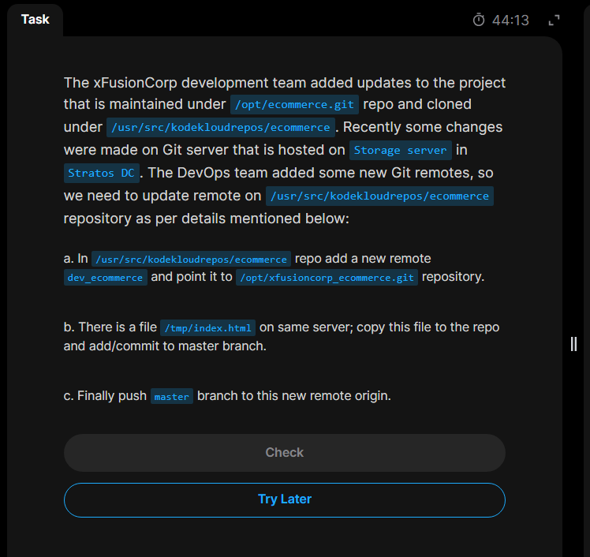

# Day 26: Git Manage Remotes

The day's task mentions that inside the storage server, new `Git remote`s were added on the git repo `/opt/ecommerce.git` which is cloned under `/usr/src/kodekloudrepos/ecommerce`. So that we need to update the remote here.

## Todo this it requests to

### 1. add a new remote `dev_ecommerce` which points to `/opt/xfusioncorp_ecommerce.git` under the `/usr/src/kodekloudrepose/ecommerce` repo.

### 2. Copy a file `/tmp/index.html` on this same repo and add/commit it to master branch.

### 3. Finally push the `master` branch to this new remote origin.



## Steps

**_1. login to storage server and change to super user_**

**_2. Navigate to the target repo and add the git remote _**
`git remote add dev_commerce /opt/xfusioncorp_commerce.git`
here, the syntax is.. `git remote add [THE REMOTE NAME] [THE DESTINATION]`

**_3. Copy the file into the current location, then add and commit the change_**
`cp /tmp/index.html .`
`git add index.html`
`git commit -m "add index.html file`

**_4. Push the master branch into this remote origin(dev_ecommerce)_**
`git push dev_ecommerce master`
Syntax here is : ```git push [destination] [branchToAdd]


Done 🫡
