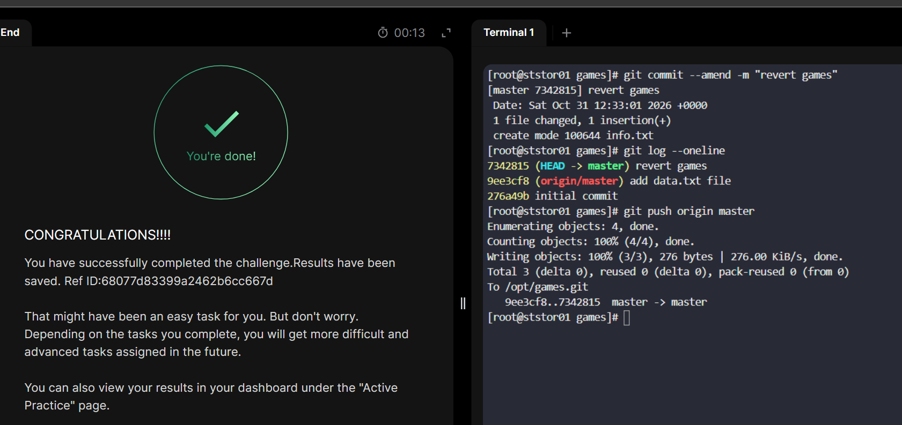

# Day 27: Git Revert Some Changes

The day's task states that a faulty commit had been pushed to a shared repository located at `usr/src/kodekloudrepos/games` and requests to..

- Revert the latest commit (_HEAD_) back to the _intitial commit_
- Use the commit message `revert games`.

## My Step-by-Step Procedure to solve:

_1. ssh login into the storage server and navigate to the target rep(`/usr/src/kodekloudrepos/games`)_

_2. Next we can log the commit history in a single-line format per commit using_
`git log --oneline`

_Here we see that the latest commit (`HEAD`) is found just above the initial commit. So we can either revert it using_ 
`git revert HEAD --no-edit`
_Or we can use the 7 characters of the commit's SHA-1 checksum located at the left beginning of the output line._
`git revert 9ee3cf8 --no-edit`
_The `--no-edit` flag here tells `Git` to skip opening the text editor and reuse the existing commit message without changes_

_3. Now let's ammend the commit by using the given commit text ie, revert-games_
`git commit --ammend -m "revert-games"`

_Then verify our latest commit is the HEAD by logging the commit history_

`git log --one-line`

_4.Finally push changes and done_

 [alt text](README.md)
