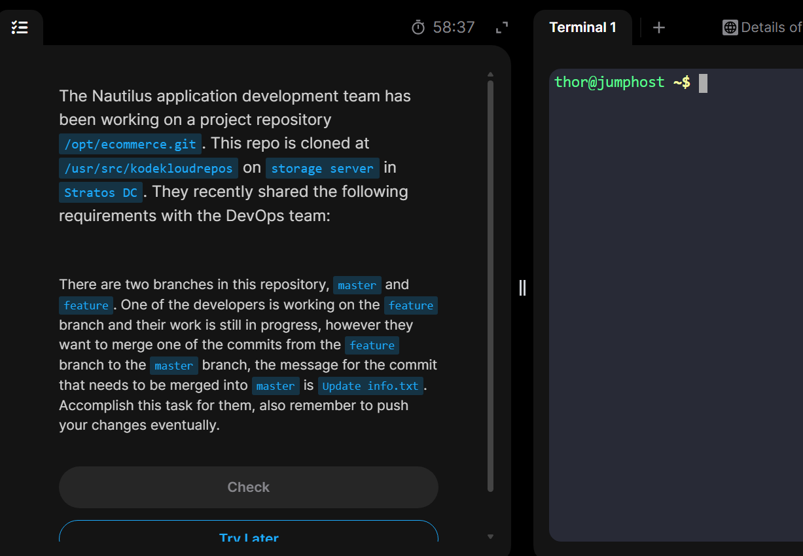

# Day 28: Git Cherry Pick

_This task teaches how to select a specific commit from one branch and apply it to another branch. Unlike `merge` or a `rebase`, which move the entire branches or blocks of history, `cherry-pick` acts as a surgical copy-and-paste tool for individual changesets._

## Task Description:

## Step-by-step Solution Procedure

### 1. First we need to `ssh login` to the storage server, then navigate to the target `git` repository.

### 2. Then let's check the branches, and make sure to update the local `master` branch to the latest.

### 3. Now we need to checkout to our target branch and log the commit history to copy the 7-figure hash text of the targeted commit(with a commit message `update info.txt` as mentioned by the task description).

### 4. Then we checkout back to the master branch to `cherry-pick` the specific commit from the `feature` branch to the `master`.

### 4. Finally push changes then we're good.

Done!
🫡

