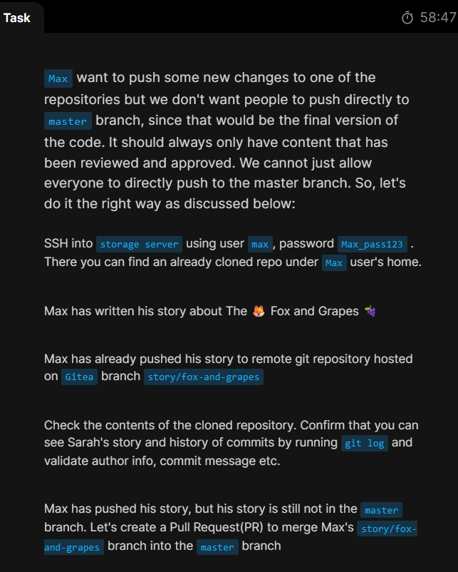
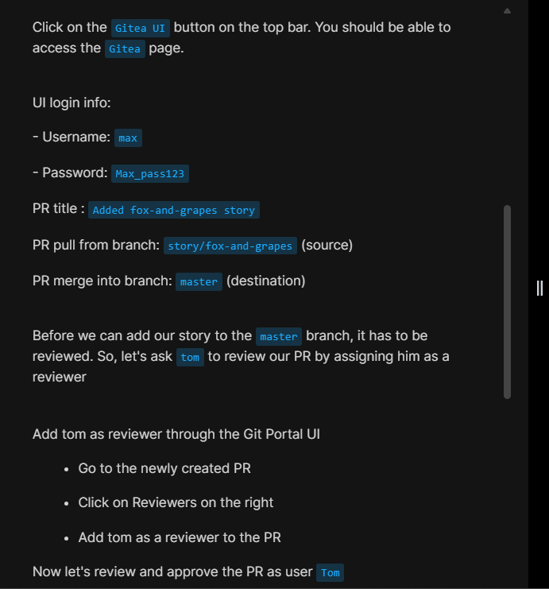
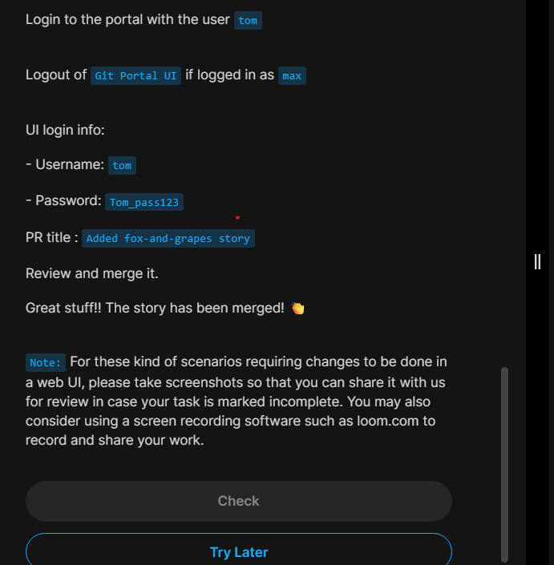
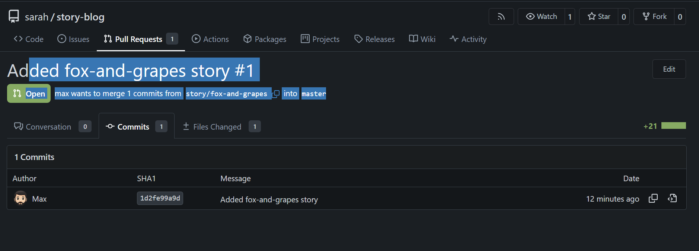

# Day 29: Manage Git Pull Requests

## Task description

The day's task requires, pushing a featuring branch, creating a pull request in `Gitea`, and merging the pull request without deleting the source branch.

## A Step-by-step procedure

_1. Login to the storage server as `max` and check the github repo, log the commit status_

\_2. Login to `Gitea` as `max` then create the `pull request`

### Make sure to put the correct _from_ and _into_ merge information and _tom_ as a reviewer as mentioned by the task description.

_3. Now, logout and signin using `tom`'s credentials to review the pull request._

_4. Check pull requests and review._

_5. Now add a merge commit to merge the request._

_6. Finally we've successfully created a pull request and merged it on `Gitea`'s UI._

