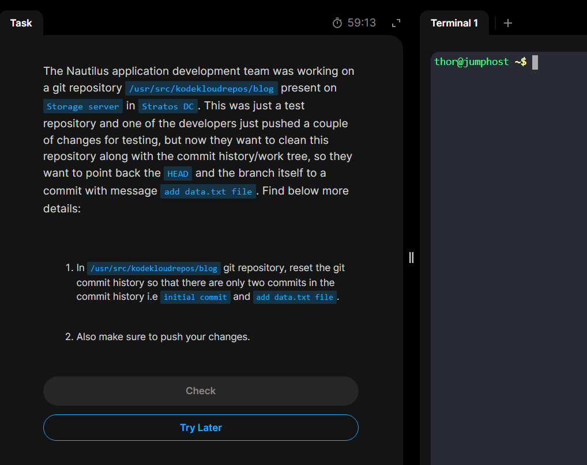

# Day 30: Git hard reset

Today's task focuses on `Git Hard Reset`

## Problem Statement:

The problem explains how to cleanup a Git repository by resetting its history and work tree to a specific commit message as mentioned in the task description(_add data.text file_) in our case. and push the updated state to the remote repository.

## Steps

_1. SSH login into the storage server and log the commit history._

_2. We can also short list the commit history in one line._

_3. Now we `git hard reset` to the specific commit mentioned above using the commit hash to make it the `HEAD`_

_4. Forcefully push the changes into the remote server_

we forcefully pushed changes because `---hard reset` rewrites the local commit history so it will fall back from the remote latest commits. But once we use ``--force` to push, the local and remote repositories both will be rewritten their commit history to the target HEAD.
so it tells the remote to ignore mismatches and make it to the local state.

_5. Completed!_

