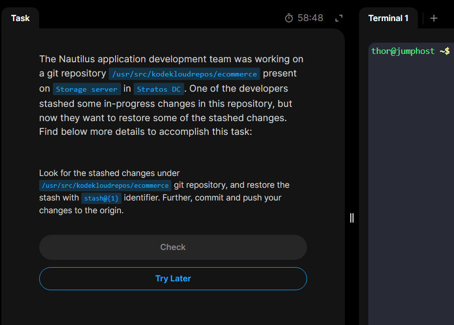

# Day31 Git Stash

## The day's task focuses of `git stash` practices and version control operations.

## Task overview:

Problem requires to list, apply and manage uncommited and stashed local changes. Stashed changes are changes we're making progress of and then have WIP(_WORK IN PROGRESS_) label when we list them using `git stash list`. Then are not seen in the local directory when we `git status`

## Steps:

_1. First we ssh login to the storage server, navigate to the target git repository and list the stashed changes(the ones with `WIP`) using `git stash list`_

### As we can see from the `git status` output above, there were nothing to commit, meaning the stashed ongoing changes are not added to our local repository.

_2. Now let's apply the stashes using the identifier `stash@{1}` and once again see the `git status` outputs._

### Now the stashed change is applied to our local repository.

_3. Finally lets commit and push the change to the remote using `git commit` and `git push`._

*4. End of today's task*😋

