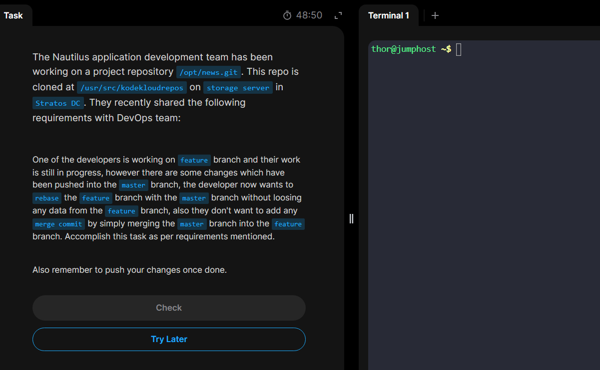

# Day 32: Git Rebase

## The day's task in short requests to rebase the `feature` branch with the `master` branch without loosing any data so that it will be updates as with the `master` without doing any `git merge`

**_1. First lets login to the storage server, navigate to the targeted directory, and see the commit history on both branches (*master* and *feature*) and where the *HEAD*'s are_**

_2. Checkout to the `feature` branch and rebase it to the `master`_
This here makes sure where exactly the branch splitted from the master, then continuing from it, it replays all the new commits in the branch onto the latest commit of the master.
`git fetch origin` then,
`git rebase master`

**_3. Now lets' `git log --oneline` to see our commit history inside the branch, there we can see that our latest commit had been replayed onto the latest of the `master` and been the `HEAD` one. and finally we add and push the changes to the `feature` branch forcefully_**

### We used `--force-with-lease` because since `rebase` overwrites the commit history in our branch(`feature`), `--force-with--lease` makes safety checks if another team mate is working on the same branch so that their commit history doesn't get error.

_4. Finally task is completed._\

///
